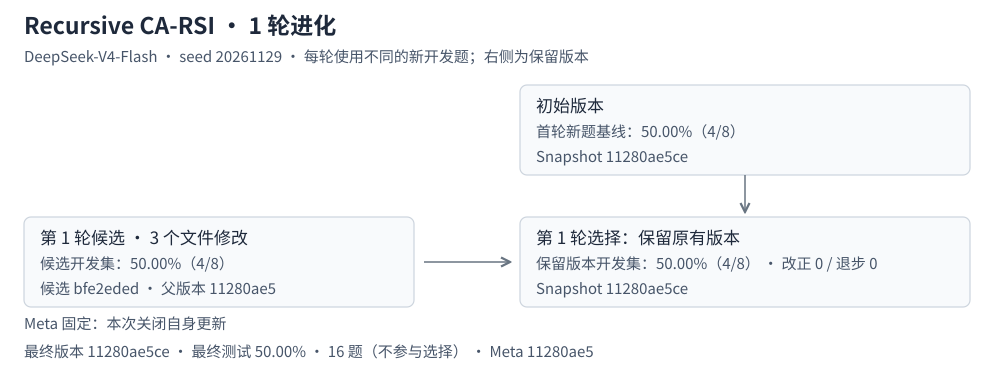
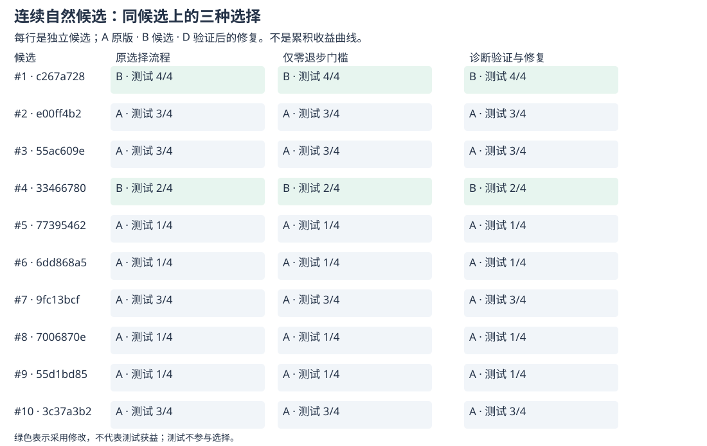

# CA-RSI：自我改进中的错误定位与修复

**我们希望回答：智能体修改自己以后，能否发现其中有害的修改，验证原因，并修复它，同时保留原有的有效部分？**

目前已经有规则级干预的受控案例，也完成了真实 RSI 流程试运行。但从“一个例子能做到”到“真实运行时能可靠做到”，还有差距。首个自然候选未完成有效归因和修复；随后完成的 10 个连续候选实验中，三种流程的选择与测试结果相同，仍未证明诊断修复能带来额外收益。

## 🆕 Updates

- **2026-11-28**：完成固定 Meta 的 **10 个连续自然候选**实验和 40 题最终测试。三种选择流程均接纳 2 个候选，EM 55.00%、F1 77.55%；未产生有效归因或修复，未观察到诊断机制的额外收益。
- **2026-11-28**：完成首个自然候选试验。规则记录和控制器重放进入真实流程，但 Meta 未给出结构化干预请求，修复未产生代码变化，最终保留初始 MiniAgent。
- **2026-11-28**：完成递归模式与 base 的四轮对照，以及独立的答案规则定位与修复试验。
- **2026-11-27**：完成初始 MiniAgent、Meta-Harness、CA-RSI 的历史对照。

[本次实验与选择图](results/continuous-diagnosis-20261128/REPORT_CN.md) · [历史交互可视化](results/evolution-live.html) · [机器修改与选择日志](results/RSI_ITERATIONS.md) · [完整历史实验记录](docs/archive/experiment-log-before-continuous-study-2026-11-28.md) · [运行说明](docs/local_run.zh-CN.md)

## 1. 研究对象与方法

所有主要实验都以 **MiniAgent** 为智能体。Task 是负责解题的版本；Meta 是提出修改、诊断和修复的角色。历史演化实验的 **base 是原版 Meta-Harness**，与“不做演化的初始 MiniAgent”分别报告。本次连续候选实验使用共享候选的独立入口，只复用原版的选择规则，不冒充原版完整端到端运行。

一次自我改进可能同时修改多个部分，总分提高也可能掩盖某些题上的退步。因此，下一阶段把定位对象限定为一项具体修改，例如删除答案括号解释或截断逗号后缀。第一版优先研究答案处理中间件中的纯转换规则，因为可以保存输入、关闭单条规则并重复执行。

流程为：**生成候选 → 保存修改与运行记录 → Meta 提出原因假设 → 控制器执行干预 → Meta 更新诊断并提出修复 → 新题决定是否采用 → 最终测试。**

原因、预测和修复应由 Meta 生成；实验类型、评分和证据记录由控制器执行。人工复核用于评估系统判断是否正确，不把人工解释记为系统自动发现。

## 2. 已有实验说明了什么

### 2.1 已知规则问题：局部验证与修复能够运行

独立规则试验围绕已知的逗号截断问题展开。输入 `Graham County, Kansas` 被截成 `Graham County`。Meta 事前预测关闭该规则能保留完整地名，控制器固定输入执行后支持该预测，随后 Meta 生成限制适用条件的修复。

| 数据 | 完整候选 | 删除逗号规则 | 模型修复 |
|---|---:|---:|---:|
| 人工训练 | 3/6 | 3/6 | 5/6 |
| 人工留出 | 2/6 | 4/6 | 5/6 |
| 历史边界代理重放 | 4/16 | 5/16 | 5/16 |

人工留出上，修复比直接删除多答对 1 例；历史重放上两者相同。4 项输出预测均命中，其中 2 项显示规则有害、2 项显示规则有用，说明“预测正确”与“发现有害规则”必须分开统计。

这支持限定输入上的局部机制解释。人工案例是在知道问题后构造的，历史输入也是代理边界，尚不能证明系统能主动发现未知自然问题。[完整报告与限制](results/rule-audit-pilot-20261128/REPORT_CN.md)

### 2.2 首个自然候选：流程接入了，但诊断修复没有成功

固定 Meta，使用 MiniAgent + `DeepSeek-V4-Flash`，train/dev/test 为 **8/8/16**，seed **20261129**，温度 0。数据在模型调用前与本地历史任务按 ID 和内容去重。

| 要回答的问题 | 实际观察 | 当前结论 |
|---|---|---|
| 有没有改坏？ | 训练检查 2/8 → 8/8；新验证集初始与完整候选均 4/8，但候选有 1 题退步 | 总分不能替代逐题检查；分数变化本身不能定位原因 |
| 找到哪里了吗？ | Meta 给出 4 条文字诊断，结构化请求为 0；部分声明与候选实际输出不符 | 未完成有效自动归因 |
| 干预验证了吗？ | 控制器在前 4 题执行 16 种规则组合，各重复两次；全部为 4/4 | 重放执行有效，但没有支持有害规则的原因判断 |
| 修好了吗？ | 修复耗尽工具轮数，未改文件；同快照重新评测为 7/8 | 没有独立修复版本，不能报告修复成功 |
| 能减少风险吗？ | 完整候选未被采用；仅 skill 修改为 5/8，但也有 1 题退步，未通过零退步门槛 | 尚无两流程的系统对照，不能声称减少了坏修改放行 |

最终保留初始 MiniAgent，测试 **EM 50.00%、F1 63.52%**。测试题与历史对照不同，不能直接比较历史 F1。记录输入加输出 **16,503,830 tokens**，演化与最终测试约 **12.89 分钟**，不含入口准备与曝光检查。

这轮还暴露了证据覆盖问题：前 4 个干预案例中规则都未改变答案，唯一的答案替换发生在第 6 题。温度 0 下未变代码的重复评测也出现分数波动，不能把这种差异解释为修复效果。

[结论与失败分析](results/fixed-meta-diagnosis-20261128/FINDINGS_CN.md) · [评估记录](results/fixed-meta-diagnosis-20261128/REPORT_CN.md) · [冻结清单](results/fixed-meta-diagnosis-20261128-plan.json) · [配置](configs/fixed_meta_diagnosis_20261128.yaml)



### 2.3 连续 10 个自然候选：完成对照，尚无诊断增益

固定初始 MiniAgent 和 Meta，使用 `DeepSeek-V4-Flash`，温度 0。按顺序保存 **10 次提议、10 个实际候选**，没有挑选成功案例。每次从同一初始版本提出修改，Meta 能看到之前的训练反馈；这是同候选上的流程对照，不是两条独立累计演化轨迹。

数据为 **8 道共享训练题、40 道验证题、40 道最终测试题**，每个候选分配不同的 4 道验证题和 4 道测试题。全部候选及选择冻结后才执行最终测试，测试不反馈给 Meta。

| 方法 | 接纳候选 | 测试 EM | 测试 F1 |
|---|---:|---:|---:|
| 初始 MiniAgent，不采用修改 | 0/10 | 52.50% | 75.05% |
| 原选择规则：验证 EM 严格提高才采用 | 2/10 | 55.00% | 77.55% |
| 仅增加零退步门槛 | 2/10 | 55.00% | 77.55% |
| 诊断、验证、修复 + 零退步门槛 | 2/10 | 55.00% | 77.55% |

三种流程都采用第 1、4 个候选。相对初始版本，最终测试多答对 1/40 题；这来自共同采用的候选，**不能归因于诊断修复**。

| 要回答的问题 | 实际结果 | 可支持的结论 |
|---|---|---|
| 有没有改坏？ | 10 个 B 在各自 4 道测试题上均未出现 EM 退步；部分候选有 F1 下降 | 本批没有 EM 定义的坏修改正例，不能估计拦截能力 |
| 找到哪里了吗？ | 80 个训练边界中仅 1 个被完整规则改变；1 条 Meta 请求引用错误输入，被拒绝；有效请求 0 | 完成记录和检查，但尚无自然有害规则的有效定位 |
| 修好了吗？ | 得到支持的有害原因 0，撤销版 C 与合格修复版 D 均未产生 | 未完成自然错误的修复验证，不补造四版本结果 |
| 能减少风险吗？ | 三组坏修改放行均 0；新测试上有 2 个改善且无 EM 退步的 B，其中 1 个被三组共同拒绝 | 没有观察到流程差异；0 次坏修改放行不代表风险降低 |
| 多花多少成本？ | 诊断与反思额外 20 次模型调用、392,750 tokens；整项研究共 1,184,156 tokens，约 30.99 分钟 | 本轮新增诊断有成本，没有显示额外收益 |

第 4 个候选的 Meta 请求把旧版完整句子当作候选规则前输入，声称规则截断了答案；保存的真实输入已经是 `Chuck Schumer`，所以请求未通过事实核对。第 10 个候选唯一改变的边界只是删除前导冠词，未改变 EM。候选内容重复较多，个别诊断文字还将 F1 下降称为改善；解释本身不能作为正确标签。

本批采用预先固定的 EM 门槛，不能把“零 EM 退步”解释成所有质量指标均无下降。独立人工参考复核尚未完成。**这次跑通了连续采集、事实核对、规则重放和同候选对照；还没有证明系统能可靠发现、解释并修复未知自然错误。**



[完整实验报告](results/continuous-diagnosis-20261128/REPORT_CN.md) · [结果、诊断与代码差异](results/continuous-diagnosis-20261128/evidence.json) · [冻结清单](results/continuous-diagnosis-20261128/plan.json) · [协议](docs/continuous-study-protocol.zh-CN.md)

### 2.4 历史演化对照：还没有稳定收益证据

下表按实验批次分开列出。各批次的起始代码或数据条件不同，不能混为一组排名。

| 实验批次 | 方法 | 测试 EM | 测试 F1 |
|---|---|---:|---:|
| 11 月 27 日单轮 | 初始 MiniAgent | 50.00% | 68.15% |
| 同批单轮 | Meta-Harness | 56.25% | 71.90% |
| 同批单轮 | CA-RSI | 50.00% | 68.15% |
| 11 月 27 日四轮 | Meta-Harness | 50.00% | 70.14% |
| 同批四轮 | CA-RSI | 50.00% | 66.49% |
| 11 月 28 日四轮 | Meta-Harness | 50.00% | 67.74% |
| 同批四轮 | Recursive CA-RSI | 50.00% | 66.73% |

历史四轮三组对照复用了同初始 Snapshot、同测试题和同 Target 配置的初始 MiniAgent 测试，不是额外新跑的独立重复。各方法候选和实际预算不同；一个种子、16 题不足以判断稳定优劣。

11 月 28 日递归模式接纳过一个 Task 文件，但该中间件没有注册，未进入实际执行；Meta 自更新接纳为 0。其已记录输入加输出 token 为 base 的 **3.49 倍**，没有显示额外收益。这也是后续必须检查“修改是否实际生效”的原因。

[历史三组一致性检查](results/three-way-hotpotqa-comparison.json) · [四轮记录](results/four-round-hotpotqa.json) · [递归与 base 对照](results/recursive-vs-base-20261128.json) · [未启用修改检查](results/recursive-vs-base-20261128-activation-check.json)

## 3. 从局部案例走向真实 RSI，还差三步

**第一步，抓到真实自修改造成的错误。** 让 RSI 连续产生修改，保存修改前后代码、执行过程和逐题结果。面对事先不知道的新问题，系统需要主动提出可疑修改。已有详细局部验证主要围绕已知问题设计，首个自然案例也没有成功完成这条链。

**第二步，检查是否找对原因。** 对系统指出的修改，固定输入，单独关闭或撤回，再比较结果。错误消失支持该判断；错误仍存在则需继续查。正常修改也要保留，检查系统是否误报。当前细粒度干预主要支持纯答案处理规则；检索、重试、规划会影响后续模型调用，需要完整轨迹对照，尚未具备同样完整的支持。

**第三步，证明检查能减少坏修改。** 对比“按原方式决定是否采用”和“增加定位、验证与修复”。在未参与修复的新题上检查坏修改放行、好修改误拦、修复新增错误及调用成本。单次拒绝候选或单个修复成功，都不足以证明流程整体更可靠。

## 4. 本轮完成后，还需要验证什么

本阶段已以 **10 个连续候选**完成可行性实验，固定 Meta。[冻结协议](docs/continuous-study-protocol.zh-CN.md)与[数据清单](results/continuous-diagnosis-20261128/plan.json)已保存。事先确定采集顺序和预算，不挑成功案例；无效、未生效、无明显变化和修复失败都保留。提议次数、实际产生修改的次数和可评估次数分别计数。

本次对同一批候选比较原选择流程、仅零退步门槛、诊断修复增强流程，共享候选及共同评估。后续需要提高自然修改的多样性和实际触发覆盖，继续按事先约定的顺序采集，不能只补挑有害案例。两套策略各自长期演化的收益仍需独立实验。

| 要回答的问题 | 每次需要汇报 |
|---|---|
| 有没有改坏？ | 改前、改后的正确与错误案例，以及逐题改正和退步 |
| 找到哪里了吗？ | Meta 指向的规则和代码、事前预测、单独撤回后的实际结果；无证据时明确说明 |
| 修好了吗？ | 原版、候选、撤销版、修复版；原错误是否消失、是否新增错误，未生成版本不补造结果 |
| 能减少风险吗？ | 两流程的坏修改放行、好修改误拦数量与分母，以及未能判断的案例 |
| 多花多少成本？ | 候选生成、诊断、干预、修复、选择、最终评估各自的调用、token 和耗时 |

诊断与修复只使用开发案例，新验证题用于决定版本，最终测试不再反馈给同一轮修复。已经看过并用于调整的任务转为开发数据。自然案例的参考判断由执行证据和人工复核共同建立；Meta 自己的声明不能直接作为正确标签。小样本新题上的退步是观测信号，也不能自动当作确定的代码因果结论。

本次入口已增加实际输入输出核对、可执行请求和反证要求，覆盖全部 8 道训练边界，并将每个 Meta 阶段限制为单次模型请求。下一步的重点是获得有足够触发覆盖的自然修改，补齐有效原因与修复的证据链。12 个受控案例可作为单条有害、规则冲突、未生效和正常无需修改的接口检查，与自然案例分开报告。

**这个规模用于发现问题、验证流程，还不足以证明稳定有效。** 本次已给出连续案例清单、三流程配对结果和失败情况；后续仍需独立参考复核、更多种子和更充分的新题。

## 5. 配置、证据与复现

主要环境为 HotpotQA distractor、官方 EM/F1 评分；Target 在 Docker 中解题，Worker 在本机进程中提出修改，模型通过 API 调用。EM 表示规范化后完全匹配，F1 衡量答案词元的重合。各批次的模型参数、初始版本和数据清单以对应配置与报告为准。

| 资料 | 入口 |
|---|---|
| 本次 10 个候选报告与选择图 | [REPORT_CN.md](results/continuous-diagnosis-20261128/REPORT_CN.md) |
| 历史交互可视化与逐轮选择 | [evolution-live.html](results/evolution-live.html) |
| 实际修改、机器理由与采用决定 | [RSI_ITERATIONS.md](results/RSI_ITERATIONS.md) |
| 历史原生运行成本，含早期排错 | [run-summary.csv](results/run-summary.csv) |
| 本次独立入口的分阶段成本 | [实验报告](results/continuous-diagnosis-20261128/REPORT_CN.md#调用成本) |
| 固定 Meta 的阶段计划 | [diagnosis-next-stage.zh-CN.md](docs/diagnosis-next-stage.zh-CN.md) |
| 规则验证接口与记录 | [RSI_RECORDING_GUIDE.md](docs/RSI_RECORDING_GUIDE.md) |
| 旧实验参数、逐轮表格和图 | [完整历史记录](docs/archive/experiment-log-before-continuous-study-2026-11-28.md) |
| 原项目介绍 | [项目说明](docs/archive/project-overview-2026-11-27.md) |

```bash
# 查看配置，不调用模型
.venv/bin/python scripts/run_experiment.py --config configs/fixed_meta_diagnosis_20261128.yaml --dry-run

# 从本次已有记录重建报告、选择图与日志，不调用模型
.venv/bin/python scripts/report_continuous_diagnosis.py runs/continuous_diagnosis_20261128 --output results/continuous-diagnosis-20261128

# 从历史原生运行重建可视化，不调用模型
.venv/bin/python scripts/export_evolution.py
open results/evolution-live.html
```

完整安装和运行命令见[本地复现说明](docs/local_run.zh-CN.md)。新实验应使用新的运行目录并冻结数据，不将复用旧测试题说成新的独立测试。

缓存读取已包含在输入 token 中，不重复累计；失败调用的已知用量计入成本，未知用量不视为零。未获得供应商实际账单时不估算金额。原始轨迹、数据集、缓存和凭据保留本地，公开记录保留必要的结果、代码差异与证据哈希。FlashRSI 保留上游 Apache-2.0 许可证。
