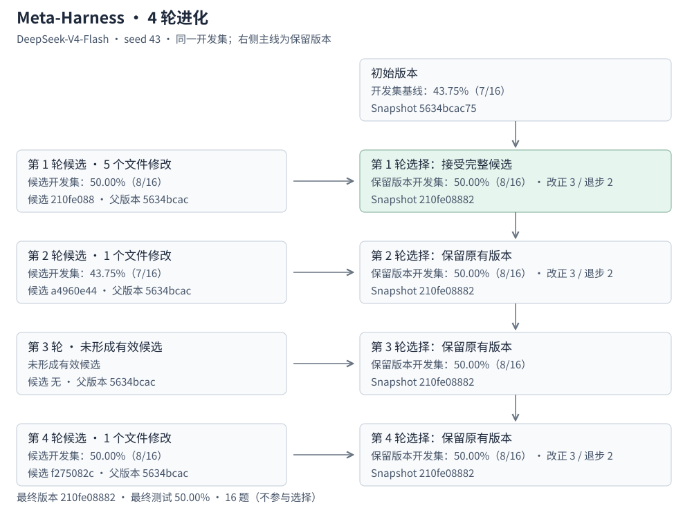
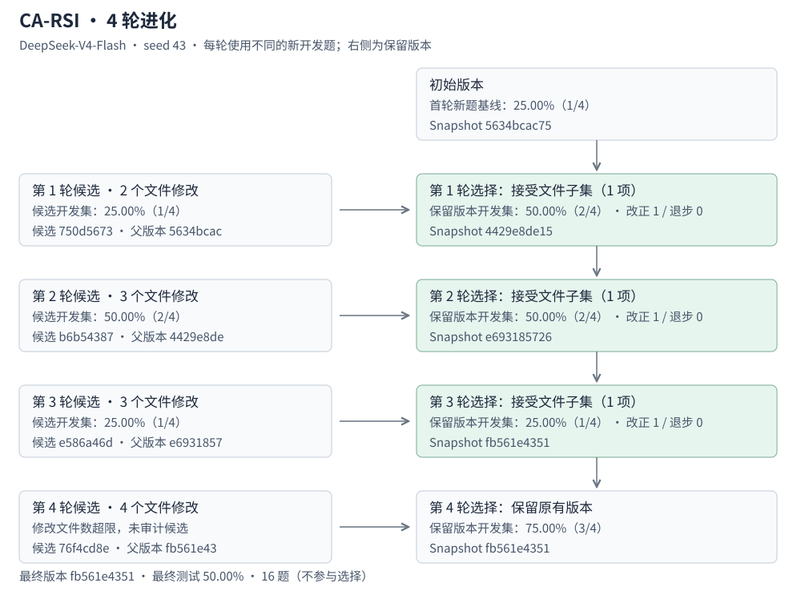

# CA-RSI 实验记录

本文件记录 base 的配置、CA-RSI 相对 base 的实验变量、实际结果和运行成本，后续实验继续追加。
当前结果更新至 **2026-11-27**，包含 HotpotQA 的单种子单轮和四轮小规模实验。
第 1–3.4 节记录历史单轮设置与结果，三组统一对照及四轮进化图见第 3.5 节。
原 README 已移至 [项目说明与阶段性分析](docs/archive/project-overview-2026-11-27.md)，
环境安装和工具使用见 [本地复现说明](docs/local_run.zh-CN.md)。

## 新增：Meta 也能更新自身的递归模式

新增 `recursive_ca_rsi`：Meta 自动诊断和修复 Task 修改，并提出自身策略的修改；
新旧 Meta 在新的下游改进任务上配对验证，通过后新版才成为下一轮 Worker。
Task 和 Meta 分别保存版本，最终测试不参与选择。
本次只完成代码与离线行为验证，尚无该新模式的真实模型性能结果；下文历史实验仍属于原版方法。
运行配置为 [`recursive_ca_rsi_hotpotqa.yaml`](configs/recursive_ca_rsi_hotpotqa.yaml)，
流程、数据划分和启动方式见 [递归模式说明](docs/recursive_ca_rsi.zh-CN.md)。

## 1. Base 配置

本文的 **base 指 FlashRSI 中的原版 Meta-Harness baseline**，配置文件为
[`configs/meta_harness_hotpotqa_pilot.yaml`](configs/meta_harness_hotpotqa_pilot.yaml)。
“初始版本”则指尚未经过演化的 MiniAgent，两者在结果表中分别列出。

### 共同运行设置

以下设置用于本次 base 和 CA-RSI 两组运行，已与各自保存的运行配置核对。

| 配置项 | 实际设置 |
| --- | --- |
| 代码基础 | FlashRSI，固定上游提交 `ab1607ae4fcfdf564d43389181e72f4f5ce651ee`，源码位于 `FlashRSI/` |
| 数据集 | `hotpotqa/hotpot_qa`，`distractor`，从 `validation` 划分 |
| 数据版本 | `1908d6afbbead072334abe2965f91bd2709910ab` |
| 任务模式与评分 | `mode: context`，`scoring: official`；开发集按答案 EM 选版本，测试集报告答案 EM 和 F1 |
| 数据划分 | train / dev / test = **8 / 16 / 16**，随机种子 **43** |
| Target / Worker | 均为 `miniagent`，模型均为 `DeepSeek-V4-Flash` |
| 模型接入 | 矩池云，`https://token.matpool.com/v1` |
| 采样与思考 | `temperature: 1`，`reasoning_effort: none`，`thinking.type: disabled` |
| 输出长度 | `unlimited_output: true`，客户端不发送输出 token 上限，辅助调用沿用该设置 |
| Target 限制 | `max_turns: 6`，`timeout: 300` 秒 |
| Worker 限制 | `max_turns: 30`，`timeout: 600` 秒，`type: agent` |
| 模型重试参数 | Target / Worker 均为 `llm_max_retries: 1` |
| 演化轮数 | `max_steps: 1` |
| 运行镜像 | 启动时指定 `--container-image ca-rsi-runtime:local` |
| 执行位置 | Target 解题评测在 Docker；Worker 在 Mac 独立 Python 子进程中编辑运行工作目录；模型推理调用矩池云 API |
| 测试边界 | 只在开发集选择版本；测试集不参与候选生成和选择 |

两组使用同一个初始 Snapshot：
`5634bcac75b89a43fdfb17545882ef3edf8224ccc75ece080725c12139af2e26`。
初始 `agent.yaml` 启用 `shell` 工具和 `main` skill，使用
`prompts/system.md` 与 `prompts/extract.md`，middleware 和 sub-agent 列表为空。

### Base 的演化规则

Base 使用 `algorithm.name: meta_harness`。Worker 读取开发集评测轨迹并生成完整候选，
完整候选的开发集 EM 严格高于当前最好版本时才替换，否则保留当前版本。
配置虽然包含 8 道训练题，原版 Meta-Harness 本轮并不使用训练题作为候选生成依据。
其演化函数、检查函数和默认提议指令已与固定上游版本核对，记录见
[`meta-harness-source-check.json`](results/local_validation/meta-harness-source-check.json)。

## 2. CA-RSI 的实验变量

CA-RSI 配置为 [`configs/hotpotqa_pilot.yaml`](configs/hotpotqa_pilot.yaml)。
共同设置沿用上表，主要变化如下。

| 变量 | Base：Meta-Harness | CA-RSI |
| --- | --- | --- |
| 算法 | `meta_harness` | `ca_rsi` |
| Worker 可见的评测记录 | 开发集轨迹 | 训练集轨迹；审计题、审计得分和选择记录不提供给 Worker |
| 修改评估方式 | 评估完整候选 | 按文件拆分修改，评估原版、完整候选及文件子集 |
| 修改文件数限制 | 未设置 CA-RSI 的文件数限制 | `max_edit_units: 3`；超限候选跳过 |
| 接受条件 | 完整候选开发集 EM 严格提高 | 组合的开发集 EM 严格提高，且逐题退步数不超过门槛 |
| 退步门槛 | 无逐题退步约束 | `max_task_regressions: 0` |
| 多轮开发题与保留检查 | 使用原版 Meta-Harness 逻辑 | 开发题按轮分配，后续轮次检查已用审计题；本次只有一轮，未验证跨轮保留效果 |

这次端到端实验同时改变了候选生成时可见的数据和选择机制，两组各自生成候选，
实际调用/token 预算也不相同。因此结果只能描述两次运行，不能单独归因于文件审计机制。
为比较选择机制，另对 CA-RSI 生成的同一候选做了选择器重放，结果见第 3.2 节。

## 3. 已完成实验及结果

### 3.1 原版 Base 与 CA-RSI 的单轮运行

| 实验 | 配置 | 开发集 EM：初始 → 最终 | 是否接受修改 | 测试集 EM | 测试集 F1 |
| --- | --- | --- | --- | ---: | ---: |
| 初始 MiniAgent（不演化） | 两组共同的初始 Snapshot | 7/16 → 7/16 | — | 8/16（50.00%） | 68.15% |
| Base：原版 Meta-Harness | `meta_harness_hotpotqa_pilot.yaml` | 7/16 → 10/16 | 是 | 9/16（56.25%） | 71.90% |
| CA-RSI | `hotpotqa_pilot.yaml` | 7/16 → 7/16 | 否，保留初始版本 | 8/16（50.00%） | 68.15% |

Base 的 Worker 修改了 `agent.yaml`、`middleware/answer_discipline.py`、
`prompts/system.md` 和 `skills/main.md` 共 4 个文件。
完整候选在开发集上改正 4 题、退步 1 题，净增 3 题，因此被接受。
对应结果见 [`meta-harness-baseline.json`](results/meta-harness-baseline.json)。

CA-RSI 的 Worker 修改了 `agent.yaml` 和 `middleware/grounded_answer.py`。
完整候选在开发集上改正 2 题、退步 3 题，EM 从 7/16 降至 6/16。
审计后没有组合满足接受条件，最终保留初始版本。
对应结果见 [`deepseek-unlimited-study.json`](results/deepseek-unlimited-study.json)。

本次 base 比 CA-RSI 多答对 **1 道测试题（6.25 个百分点）**。
目前只有一个种子和 16 道测试题，尚无多种子、等预算结果支持稳定的优劣结论。

### 3.2 同一候选上的选择器对照

以下方法使用同一份 CA-RSI 候选及开发集审计矩阵，选择版本后评估测试集。
相同 Snapshot 的测试结果复用，不为每个选择器重复调用模型。

| 选择方法 | 最终开发集 EM | 所选版本的开发题退步数 | 测试集 EM | 测试集 F1 |
| --- | ---: | ---: | ---: | ---: |
| 保留初始版本 | 7/16 | 0 | 8/16（50.00%） | 68.15% |
| 直接接受完整候选 | 6/16 | 3 | 6/16（37.50%） | 59.40% |
| 完整候选严格提高才接受 | 7/16 | 0 | 8/16（50.00%） | 68.15% |
| 逐项贪心选择 | 7/16 | 0 | 8/16（50.00%） | 68.15% |
| CA-RSI 新题组合选择 | 7/16 | 0 | 8/16（50.00%） | 68.15% |

本轮共评估 4 种文件组合。其中只修改 `agent.yaml` 的组合引用了未加入的 middleware，
16 道开发题全部执行失败；只加入 middleware 文件的组合则为 7/16，改正 1 题、退步 1 题。
文件依赖不完整导致的失败不能直接解释为某个语义修改有害。
CA-RSI、完整候选严格提高才接受和贪心法均保留初始版本，本轮未观察到 CA-RSI 相对后两者的额外收益。

### 3.3 运行成本

| 运行范围 | 输入 tokens | 输出 tokens | 其中缓存读取 tokens | 用量缺失条目 | 启动器耗时 |
| --- | ---: | ---: | ---: | ---: | ---: |
| Base 原生单轮（含最终测试） | 729,480 | 7,954 | 611,451 | 0 | 320.76 秒 |
| CA-RSI 原生单轮（含最终测试） | 1,061,457 | 10,706 | 913,654 | 16 | 525.91 秒 |
| 完整候选的补充独立测试 | 35,784 | 63 | 32,635 | 0 | 98.02 秒 |
| CA-RSI 原生运行 + 补充测试 | 1,097,241 | 10,769 | 946,289 | 16 | — |

缓存读取 tokens 已包含在输入 tokens 中，不重复相加。
CA-RSI 的 16 条缺失用量来自失败轨迹，表中 token 是已记录用量，缺失值不视为已知零消耗。
供应商没有返回实际费用，当前不报告金额；启动器耗时包含数据准备、演化和测试。
完整审计矩阵属于共同采集成本，不能将其重复算作每个重放选择器的独立实测成本。

所有运行（含早期排错）的成本记录见 [`run-summary.csv`](results/run-summary.csv)。
早期的输出额度耗尽运行，以及随后候选修改文件过多而被跳过的运行，保留为排错历史，
不与本次关闭思考、输出不设客户端上限的主实验混为一组。

### 3.4 本地运行标识

完整轨迹位于本地 `runs/`，该目录不提交；仓库保留配置、结构化结果和成本汇总。

两组的逐轮修改、文件差异、组合得分和最终选择可在
[`进化可视化`](results/evolution-view.html) 中查看。
通过统一实验脚本或根目录 `scripts/run_experiment.py` 完成实验后自动更新页面，保留历史运行。
也可运行 `.venv/bin/python scripts/export_evolution.py` 手动重建，不调用模型；
其他运行目录的用法见 [本地复现说明](docs/local_run.zh-CN.md#逐轮进化可视化)。

| 记录 | 本地运行标识 |
| --- | --- |
| Base | `meta_harness-miniagent-hotpotqa-20261127-183624-453530` |
| CA-RSI | `ca_rsi-miniagent-hotpotqa-20261127-182117-253432` |
| 完整候选补充测试 | `evaluation-miniagent-hotpotqa-20261127-183044-698897` |

### 3.5 三组对照：初始 MiniAgent 与四轮演化（2026-11-27）

本次新开两个独立进程，分别运行原版 Meta-Harness 和 CA-RSI，各配置 4 轮。
模型、采样、输出长度、Target/Worker 限制、数据版本和评分方式沿用第 1 节；
train/dev/test 仍为 **8/16/16**，seed **43**。两次运行的初始 Snapshot、
16 道开发题和 16 道测试题内容已逐条核对一致。
这是两次独立演化，不是把第 3.1 节的单轮结果接着运行三轮。
结构化结果、逐轮选择和完整成本统计见
[`four-round-hotpotqa.json`](results/four-round-hotpotqa.json)。

为判断演化是否优于未修改的 agent，下表同时加入**初始 MiniAgent、不做 RSI** 的已有测试结果。
该结果复用自第 3.1 节 CA-RSI 保留初始 Snapshot 后的最终测试，EM 为 8/16、F1 为 68.15%。
已进一步核对三组的初始 Snapshot、16 道测试题内容和完整 Target 配置均一致。
本次只整理已有记录，没有重新调用模型；结果来源和一致性检查见
[`three-way-hotpotqa-comparison.json`](results/three-way-hotpotqa-comparison.json)。

| 方法 | 配置轮数 / 有效候选评测轮数 | 最终版本 | 测试集 EM | 测试集 F1 |
| --- | --- | --- | ---: | ---: |
| 初始 MiniAgent，不做 RSI（历史测试复用） | 0 / 0 | 初始 Snapshot `5634bcac75` | 8/16（50.00%） | 68.15% |
| Base：Meta-Harness | 4 / 3 | 第一轮完整候选 `210fe08882` | 8/16（50.00%） | 70.14% |
| CA-RSI | 4 / 3 | 第三轮保留版本 `fb561e4351` | 8/16（50.00%） | 66.49% |

三组主要指标 EM 均为 **50.00%**，本次没有观察到演化带来的 EM 提升。
相对初始 MiniAgent，Meta-Harness 的 F1 高约 **1.98 个百分点**，
CA-RSI 的 F1 低约 **1.67 个百分点**；Meta-Harness 比 CA-RSI 高约 **3.65 个百分点**。
目前只有一个种子、16 道测试题，尚不能判断稳定优劣。
两组候选来源不同、生成时可见的数据不同，实际 token 预算也不同，
不能把差异单独归因于 CA-RSI 的组合审计机制。

**Base 的逐轮选择。** 每轮仍从初始 Snapshot 提出候选，Worker 可检索该次运行的历史。
完整候选只有严格超过历史最高开发分数才替换；同分保留之前的版本。

| 轮次 | 相对初始版本提出的修改 | 候选开发集 EM | 本轮选择 |
| --- | --- | ---: | --- |
| 1 | 5 个文件：配置、答案处理 middleware、system/extract prompt 和 main skill | 8/16 | 接受完整候选，改正 3 题、退步 2 题 |
| 2 | 新增 `middleware/answer_format.py`，未在配置中启用 | 7/16 | 保留第一轮版本 8/16 |
| 3 | Worker 留下不符合组件规则的 `.scratch/replay.py` | 未评测 | 候选检查失败，保留第一轮版本 |
| 4 | 新增 `middleware/answer_shaping.py`，未在配置中启用 | 8/16 | 与历史最好同分，保留第一轮版本 |

最终保留 `agent.yaml`、`middleware/answer_format.py`、`prompts/system.md`、
`prompts/extract.md` 和 `skills/main.md` 这 5 个文件的修改。
第三轮失败的原始原因是 `path must match exactly one component: .scratch/replay.py`，
它属于候选文件检查失败，不是一次得分为零的评测。



**CA-RSI 的逐轮选择。** 全部 16 道开发题分为 4 组，每轮只使用 4 道新题。
下表的各轮分数对应不同题目，不能连成同一批题上的提升曲线，也不等于最终版本在完整开发集上的得分。
后续轮次选中的组合还须通过之前已用题目的保留检查。

| 轮次 | 提出修改的文件数 | 本轮原版 → 完整候选 EM | 选择后本轮新题 EM | 保留的修改与检查 |
| --- | ---: | --- | ---: | --- |
| 1 | 2 | 1/4 → 1/4 | 2/4 | 只保留 `prompts/system.md`；改正 1 题，退步 0 题 |
| 2 | 3 | 1/4 → 2/4 | 2/4 | 只保留 `prompts/extract.md`；4 道旧题退步 0 题 |
| 3 | 3 | 0/4 → 1/4 | 1/4 | 只保留 `prompts/extract.md`；8 道旧题退步 0 题 |
| 4 | 4 | 原版 3/4；候选未评测 | 3/4 | 超过 `max_edit_units: 3`，跳过审计，保留第三轮版本 |

第一轮两个单文件组合均为 2/4，按既定的同分规则选择 `prompts/system.md`。
第二轮、第三轮也存在多个同分组合，选择器优先修改更少的组合，再按固定文件顺序决胜。
最终相对初始版本只保留 `prompts/system.md` 和 `prompts/extract.md` 的修改。
第四轮提出的 `agent.yaml`、`middleware/answer_format.py`、`prompts/system.md`、
`skills/main.md` 四项修改全部未进入本轮审计，没有放宽上限后补跑。



**已观察到的归因限制。** `prompts/extract.md` 用于 `read_url` 的网页摘要，
本次 CA-RSI 目标轨迹没有调用 `read_url`，因此不能把第二、三轮的非零分数增益解释为该提示修改的效果。
同样，base 第二、四轮的新 middleware 没有在 `agent.yaml` 注册，不能解释为这些代码生效后带来得分变化。
模型温度为 1，各版本分别调用模型，数据划分 seed 不等于模型采样 seed。
这些现象说明单次采样和每轮 4 道新题的结果存在归因不确定性；
本次尚未通过重复评测或控制模型随机性来解决这一问题。

**运行成本。** 以下只统计这两次新的四轮运行，包含最终测试和未被采纳候选的 Worker 用量。
初始 MiniAgent 对照复用已有测试，没有新增调用成本；原历史 CA-RSI 的整场演化成本不归入无 RSI 对照。

| 运行 | 输入 tokens（含缓存） | 输出 tokens | 缓存读取 tokens | 用量条目 | token 用量缺失 | 启动器耗时 |
| --- | ---: | ---: | ---: | ---: | ---: | ---: |
| Base 四轮 | 4,919,088 | 63,516 | 4,396,145 | 204 | 0 | 792.08 秒 |
| CA-RSI 四轮 | 4,386,493 | 29,974 | 3,862,521 | 279 | 0 | 1,085.89 秒 |

CA-RSI 的已记录输入加输出 token 总量更少，但用量条目更多；缓存读取已包含在输入中，不重复相加。
两组由独立进程并行运行，耗时包含准备、演化和测试，不能据此推断独占资源时的速度差异。
供应商未提供实际费用，因此不报告金额，也不把 token 更少直接解释为实际费用更低。

本地运行标识：

- 初始 MiniAgent 的历史测试来源：`ca_rsi-miniagent-hotpotqa-20261127-182117-253432`，最终测试 Snapshot 为 `5634bcac75`
- Base：`meta_harness-miniagent-hotpotqa-20261127-193656-488919`
- CA-RSI：`ca_rsi-miniagent-hotpotqa-20261127-193749-026674`

完整轨迹仍在本地 `runs/study/`；仓库保留结构化结果、成本汇总、交互可视化和上面的 SVG 图。

## 4. 后续实验变量与记录方式

后续每次实验在本 README 追加日期、配置文件、相对 base 改了什么、种子、实际预算、
开发集选择结果、最终测试 EM/F1、退步题数、运行标识和结果文件。
未修改的共同设置沿用第 1 节；模型、划分、候选来源或预算有变化时单独写明。

| 待实验内容 | 变化的变量 | 现有配置或需要补充的设置 | 当前状态 |
| --- | --- | --- | --- |
| HotpotQA 扩大规模并进行多轮演化 | train/dev/test 改为 16/128/256，轮数改为 4 | [`hotpotqa_formal.yaml`](configs/hotpotqa_formal.yaml) | 仅配置模板，未运行 |
| SearchQA 复验 | 更换数据集和评分方式，使用 16/128/256、4 轮 | [`searchqa_formal.yaml`](configs/searchqa_formal.yaml) | 仅配置模板，未运行 |
| 多种子重复 | 在同一设置下改变随机种子 | 启动器支持 `--seed`；正式种子集合尚未固定 | 未完成 |
| 等预算端到端对照 | 在统一调用/token 预算下比较 Base 和 CA-RSI | 需先固定预算及超限处理；同轮数不等于同预算 | 未完成 |
| 跨轮保留检查消融 | 比较启用与关闭保留检查 | 尚需补充消融配置和对照结果 | 未完成 |

## 5. 复现入口

在仓库根目录初始化环境，本地 `.env` 填写 API 凭据，密钥不提交：

```bash
sh scripts/setup.sh
docker build -t ca-rsi-runtime:local -f docker/runtime.Dockerfile docker
```

后续实验推荐使用统一脚本，模型、轮次、种子、数据规模、修改文件数和退步门槛集中在脚本开头：

```bash
bash scripts/run_study.sh --dry-run  # 查看配置，不调用模型
bash scripts/run_study.sh            # 默认两组各运行 4 轮，结束后自动更新可视化
open results/evolution-view.html
```

例如 `MODEL=DeepSeek-V4-Flash ROUNDS=4 SEEDS="43 44 45" bash scripts/run_study.sh`。
完整参数说明见 [统一实验脚本](docs/local_run.zh-CN.md#统一实验脚本)。
默认数据规模仍为 8/16/16，只用于小规模验证；本次已完成的四轮结果见第 3.5 节。

以下命令复现历史单轮设置，会调用真实模型并产生新运行：

```bash
# Base：原版 Meta-Harness
.venv/bin/python scripts/run_experiment.py \
  --config configs/meta_harness_hotpotqa_pilot.yaml \
  --container-image ca-rsi-runtime:local

# CA-RSI
.venv/bin/python scripts/run_experiment.py \
  --config configs/hotpotqa_pilot.yaml \
  --container-image ca-rsi-runtime:local
```

模型名是服务方的模型 ID，尚非不可变权重版本；重新实验时需保留运行日期、实际返回的模型标识和参数。
同候选选择器重放、冻结测试版本和成本汇总的使用方法见 [本地复现说明](docs/local_run.zh-CN.md)。
FlashRSI 保留上游 Apache-2.0 许可证，历史修改补丁见
[`flashrsi-ca-rsi-ab1607a.patch`](patches/flashrsi-ca-rsi-ab1607a.patch)。

### 规则级机制验证（首轮）

[操作指南](docs/rule-audit.zh-CN.md) · [实际结果与限制](results/rule-audit-pilot-20261128/REPORT_CN.md)。已支持固定输入的规则干预和固定 Meta 实验；首轮是确定性答案转换的受控试验及历史重放，尚未证明完整 RSI 收益。
