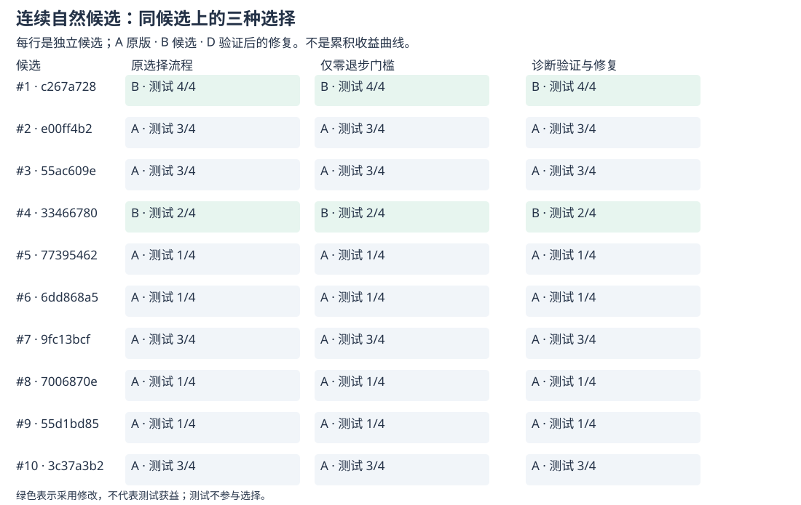

# 连续自然修改：固定 Meta 的同候选对照

共完成 10 个实际候选，来自 10 次按顺序保存的模型提议。无效提议和未成功修复不删除。
本次为限定答案处理规则的可行性实验。MiniAgent 直接提交 JSON 文件补丁，控制器应用；每阶段一次模型调用，不使用编辑工具循环。
两种流程共享候选及评估；另加入“只加零退步门槛”的对照，区分严格门槛和诊断修复的作用。不是两套策略各自演化的等预算实验。

## 数据与选择边界

执行框架起点为 `3ec2cf8d200107353ee79b794aba9dab745126bb`；独立实验脚本及配置的冻结 SHA-256 见 plan.json，代码差异见 evidence.json。本结果只对应这次冻结执行。
固定初始 MiniAgent 与固定 Meta；HotpotQA、DeepSeek-V4-Flash、温度 0。8 道训练题共享，各候选分配 4 道不同验证题和 4 道不同测试题，总划分 8/40/40。
从 128 题候选池中按预定种子排序并排除历史曝光，冻结 ID 与内容；测试在全部候选和选择冻结后统一评估，不反馈给 Meta。
每个候选从相同初始版本提出，Meta 可见之前提议及训练反馈，不可见验证或测试结果。重复内容仍记录，不能把模型随机性造成的分数差解释为代码效果。

## 流程对照

| 流程 | 接纳候选数 | 观测坏修改放行 | 观测好 B 被保留原版阻挡 | 最终测试 EM | 最终测试 F1 |
|---|---:|---:|---:|---:|---:|
| 初始 MiniAgent（不选择修改） | 0/10 | — | — | 52.50% | 75.05% |
| 原选择规则 | 2/10 | 0 | 1/2 | 55.00% | 77.55% |
| 仅零退步门槛 | 2/10 | 0 | 1/2 | 55.00% | 77.55% |
| 诊断验证与修复 + 零退步门槛 | 2/10 | 0 | 1/2 | 55.00% | 77.55% |

“观测坏修改”指选中版本在该候选的 4 道测试题上至少使一道原本答对的题退步；“观测好 B”指 B 在这 4 题上严格提高 EM 且无退步；阻挡指该流程选择 A。分母为 0 时比例未定义，只展示计数。
这些是小样本、独立模型调用下的结果，不是已经确立的因果真值或通用误报率。独立人工参考复核尚未完成。
坏修改与门槛均按预先固定的 EM 定义；EM 不变但 F1 下降不计入上述坏修改数，仍在逐版本结果中保留。因此零个 EM 退步不等于所有答案质量都未下降。

## 连续候选清单

| 候选 | 候选训练 EM | 可重放边界 | 合法预测 | 有害原因得到局部支持 | 产生合格 D | 验证选择：原/仅门槛/增强 |
|---|---|---:|---:|---:|---|---|
| 1 | B 37.50% | 8 | 0 | 0 | 否 | B / B / B |
| 2 | B 37.50% | 8 | 0 | 0 | 否 | A / A / A |
| 3 | B 37.50% | 8 | 0 | 0 | 否 | A / A / A |
| 4 | B 37.50% | 8 | 0 | 0 | 否 | B / B / B |
| 5 | B 37.50% | 8 | 0 | 0 | 否 | A / A / A |
| 6 | B 37.50% | 8 | 0 | 0 | 否 | A / A / A |
| 7 | B 37.50% | 8 | 0 | 0 | 否 | A / A / A |
| 8 | B 37.50% | 8 | 0 | 0 | 否 | A / A / A |
| 9 | B 37.50% | 8 | 0 | 0 | 否 | A / A / A |
| 10 | B 37.50% | 8 | 0 | 0 | 否 | A / A / A |

有规则边界的候选 10/10；合法 Meta 请求 0，引用不合格请求 1，有害原因得到局部支持的请求 0，合格修复 0。
完整规则相对全部关闭实际改变答案的边界为 1/80，分布在 1 个候选中。保存了边界不等于规则触发，也不等于包含有害规则；未触发案例不能证明定位能力。
控制器在学习边界上发现的单规则关闭后恢复正确的案例对为 0。没有正例时定位召回率无法估计；没有请求时预测准确率无法估计，不填成 100%。
C 只撤回 Meta 首个获得控制器支持的有害规则请求，保留候选其余修改；D 必须改善同一批冻结边界且不新增退步，才进入新题选择。没有支持的原因时 C/D 缺席，不能补造四个版本。
全部可用训练边界均进入规则组合审计，包含未改变答案和有益规则；无法重放、边界缺失、输入输出引用不符均保留。每个规则组合重复两次。

## 调用成本

| 阶段 | 输入 token | 输出 token | 用量条目 |
|---|---:|---:|---:|
| learning | 224,773 | 441 | 88 |
| proposal | 182,665 | 11,852 | 10 |
| diagnosis | 293,128 | 4,562 | 10 |
| reflection_and_repair | 92,561 | 2,499 | 10 |
| validation | 185,410 | 417 | 80 |
| final_test | 185,300 | 548 | 80 |

合计输入加输出 1,184,156 tokens。缓存读取已包含在输入中，不重复相加。
本次正式运行耗时 30.99 分钟；包含模型等待与控制器执行，不含事前数据准备。局部重放未单独计时。
用量从原始 trajectories 重算：本次通用评估缓存不符合旧汇总器的 cache/target 目录约定，旧 result 的用量字段漏计。公开报告以原始调用记录为准，分阶段输入和输出均已与总数核对。
候选和共同评估成本只计一次；诊断与反思/修复属于增强流程额外调用。最终测试所有冻结版本用于离线比较，其费用属于研究测量成本。
增强流程的诊断与反思/修复额外记录 20 个用量条目、392,750 tokens；共用的提议、学习评估与验证为 605,558 tokens。控制器纯规则重放不调用模型。
用量条目不等于供应商账单请求数；未返回实际费用。失败已知用量保留，未知用量不视为零。

## 当前可汇报范围

这批连续案例用于检查系统能否发现未知错误、执行干预和避免无依据修复。需要结合逐个诊断、控制器证据和新题结果解释，不能只按总分推断因果。
即使局部干预支持原因，也不保证修复在新题泛化；即使更严格流程放行更少坏修改，也可能误拦有用改进。比较增强流程与仅门槛流程，才能检查诊断修复是否增加了价值。
检索、重试和规划尚未纳入同样完整的干预；10 个候选及每候选 4 道测试题不足以证明稳定有效。

原始本地记录：`runs/continuous_diagnosis_20261128`。公开证据省略数据集上下文与完整轨迹，以哈希关联原始记录。
